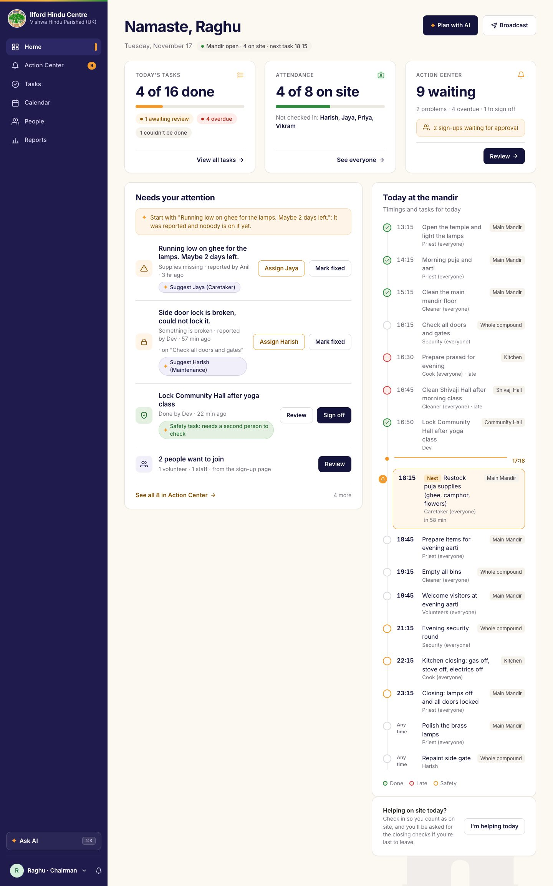
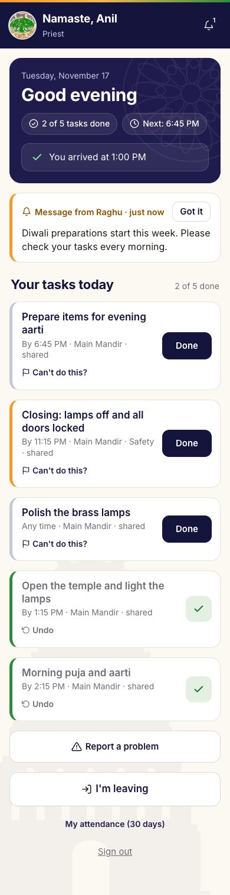
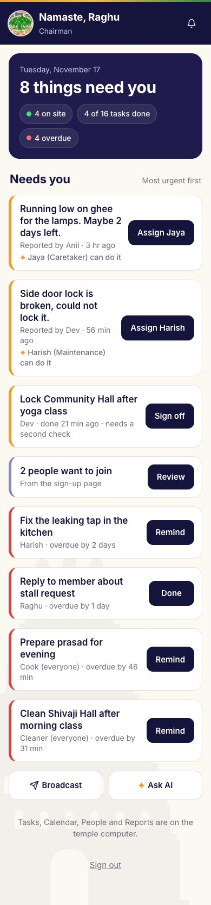

# Temple AI – Operations & Management System
**Ilford Hindu Centre · Vishwa Hindu Parishad (UK)**

> ### 📋 Presenting today? Start with **[docs/PRESENTATION.md](docs/PRESENTATION.md)**
> The script: what's built (with screenshots), what to say, what's next, and how to run and deploy it.
> Full status by page: **[docs/PROGRESS-REPORT.md](docs/PROGRESS-REPORT.md)** · How it works: **[docs/HANDOVER.md](docs/HANDOVER.md)**

A web app for running the temple day to day:
- **Admin app** for the chairman and committee (desktop, and "Needs you" on a phone).
- **Staff phone app** for priests, cooks, cleaners and volunteers.
- **Sign-up page** for new volunteers and staff.

| Home (chairman) | Staff phone | Rao garu's phone |
|---|---|---|
|  |  |  |

### Where we are (17 Nov 2026)

| Phase | What | Status |
|---|---|---|
| 0 | Setup: repo, standards, demo accounts | ✅ Done |
| 1 | Sign in, roles, people, sign-up with chairman approval, notifications, audit log | ✅ Done |
| 2 | Tasks (repeat, safety sign-off, no-deadline), problems, attendance (check in/out, last-person lock-up) | ✅ Done |
| Design | Every Phase 1–2 screen built to the agreed Stitch designs. Also working: Broadcast, Calendar (month/day), Reports and Activity log, Ask AI (live-data preview), Rao garu's phone | ✅ Done |
| 3 | Hall bookings + Temple Rules, Google Calendar two-way sync, Temple AI (Claude) | ⏳ Next |
| 4 | AI nightly report, festival Home, per-area committee access, sign-up link/QR | ⏳ |
| 5 | Testing with the committee, deployment, release 1.0 | ⏳ |

All screens: [docs/screenshots/](docs/screenshots/)

| Part | Stack | Folder |
|---|---|---|
| Frontend | React 19 + TypeScript + Vite | [frontend/](frontend/) |
| Backend | Node.js + Express 5 (JavaScript, ES modules) | [backend/](backend/) |
| Database | PostgreSQL | [backend/database/migrations/](backend/database/migrations/) |
| Docs | Presentation, progress report, handover, phase notes | [docs/](docs/) |

## Run it locally

You need Node 20+ and PostgreSQL 14+.

```bash
# 1. Backend
cd backend
cp .env.example .env          # then edit: DB_USER, DB_PASSWORD, JWT_SECRET (see comments in the file)
npm install
createdb temple_ai            # or create the database in pgAdmin
npm run db:reset              # creates the tables and the demo accounts
npm run dev                   # API on http://localhost:5000

# 2. Frontend (second terminal)
cd frontend
cp .env.example .env
npm install
npm run dev                   # app on http://localhost:5173
```

Open the app and sign in with a demo account. Every demo account uses `DEMO_PASSWORD` from `backend/.env` (default `Temple@1234`).

| Role | Email | Lands on |
|---|---|---|
| Chairman | raghu@temple.demo | Admin (can add/edit people) |
| Committee | meena@temple.demo, suresh@temple.demo | Admin (view only for people) |
| Staff | anil (priest), kamla (cook), ramesh (cleaner), jaya (caretaker), dev (security), harish (maintenance) `@temple.demo` | Mobile staff home |
| Volunteer | priya@temple.demo, vikram@temple.demo | Mobile staff home |
| Pending registrations | anita@temple.demo, mohan@temple.demo | Can't sign in until the chairman approves them |

New people can also sign up at `/register`; the chairman approves or rejects them on the People page.

**Emails:** with `SMTP_HOST` empty (the default), every email is printed in the backend terminal instead of being sent. Fill in the SMTP lines in `backend/.env` to send real email.

**Mac users:** macOS uses port 5000 for AirPlay Receiver. Set `PORT=5001` in `backend/.env` and `VITE_API_PROXY_TARGET=http://localhost:5001` in `frontend/.env`.

## Database commands (backend/)

| Command | What it does |
|---|---|
| `npm run db:migrate` | Applies any new files in `database/migrations/`. Run after pulling. |
| `npm run db:seed` | Adds the demo accounts (skips ones that exist). |
| `npm run db:reset` | **Wipes everything**, then migrates and seeds. Development only. |

## Working together

- `main` always works. Each module is built on its own branch (`phase-1`, `feature/tasks`, `feature/attendance`, …) and the other person reviews it before it merges.
- Read [docs/STANDARDS.md](docs/STANDARDS.md) before writing code (naming, API shape, folders).
- At the end of each phase, add `docs/phases/phase-N.md` describing what was built.
